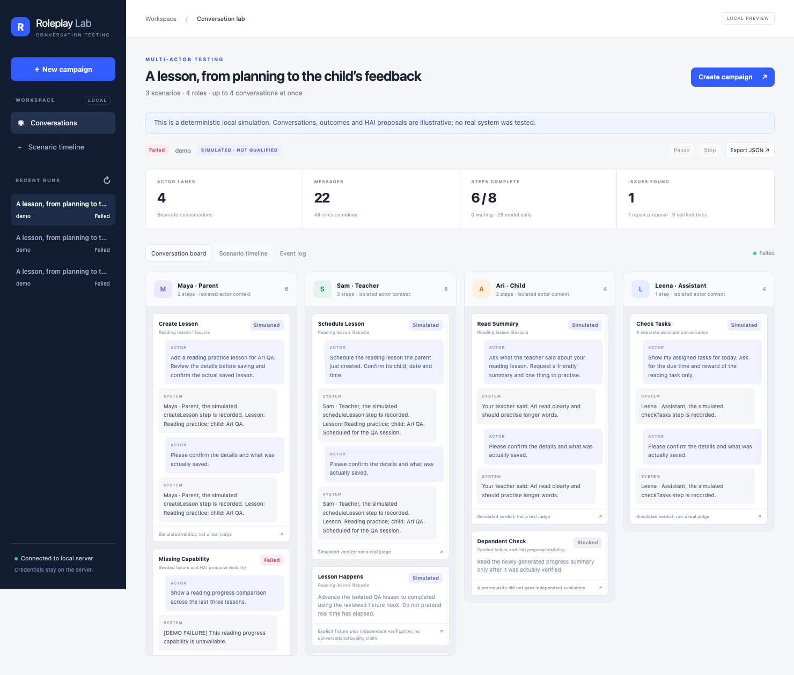
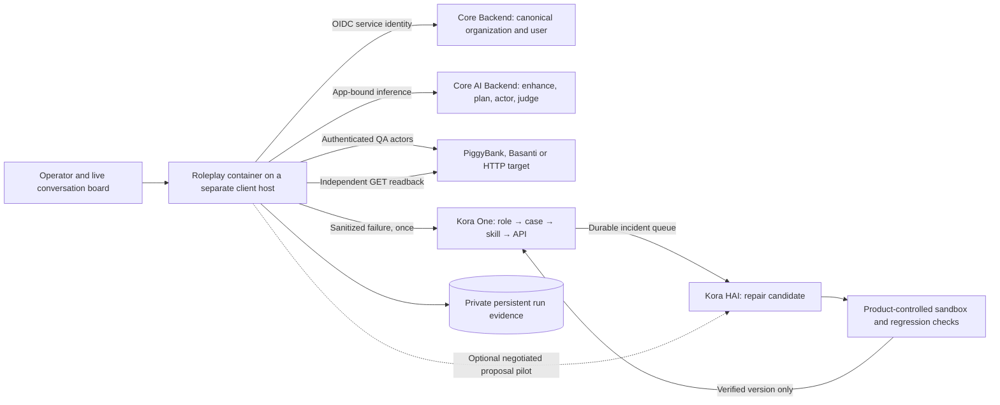

# Conversation Roleplay

[](https://github.com/SeKondBrainAILabs/conversation-roleplay/actions/workflows/test.yml)
[](LICENSE)

A reusable, MIT-licensed conversation testing module for PiggyBank, Basanti and other conversational systems. Give it roles and a brief; an LLM expands the personas, proposes scenarios, and plays each actor through adaptive turns. Independent stories run concurrently. Steps in a shared story wait for their prerequisites and receive only verified exported facts.

The local dashboard shows an actor conversation board, scenario dependencies, per-turn evaluation, independent API evidence and HAI proposal status. You can pause, stop, inspect archived runs and export sanitized JSON.

The service deployment uses **Core Backend for canonical workspace identity**, **Core AI Backend for all actor/planner/judge inference**, **Kora One for the shared capability map and incident queue**, and **Kora HAI for repair candidates**. A standalone Docker container can run on a different machine from the products, exercising the network path a real client uses. The local demo remains available without any of those services.



## Watch actual conversations

The dashboard opens the active live campaign automatically and discovers newly started live runs every five seconds. It never starts a campaign by opening a page. Simulation runs are labelled separately and are only started explicitly under the developer example.

Each role has a lane showing timestamped actor messages and actual product replies. A running step reports whether the actor is composing, the product reply is pending, independent API state is being read, the judge is evaluating, or HAI is working. Elapsed time and the last event make stalled requests visible. Finished-step counts include failures and blocked steps; issues remain counted separately. Completed runs are labelled as saved records rather than connected live streams. Select a step for the full transcript, saved conversation/message IDs, observer checks and repair receipts; the timeline shows prerequisites and blocked handoffs. Copy the URL with `?run=RUN_ID` to reopen the exact saved run. A bookmarked or manually selected run stays selected when another campaign starts.

Creating a follow-up starts with the selected live campaign as a reviewable draft, preserving its real target, QA world, roles and observer hooks; opening or editing it sends no product messages. The planner receives configured world IDs and actor bindings, never credentials, and rejects invented world/actor combinations.

Live campaigns need configured QA identities, service credentials and reviewed GET-only observers. The module does not manufacture replies or mark an assistant's success claim as verified. Actor/judge calls go through the configured model service; target calls go through the actual product adapter. This web-chat transport does not substitute for WhatsApp or voice qualification.

## Run locally

Requires Node.js 22 or later. No package installation, product dependency or external service is needed for the demo.

```sh
git clone https://github.com/SeKondBrainAILabs/conversation-roleplay.git
cd conversation-roleplay
npm start
# Open http://127.0.0.1:4318 and click Run interactive demo
```

The included example follows **parent creates lesson → teacher schedules → an explicit QA fixture simulates the lesson happening → teacher records feedback → child reads a summary**. An assistant conversation runs alongside. A separate seeded failure shows a HAI proposal and a blocked dependent step.

**Demo mode is deterministic simulation. It does not call an LLM, PiggyBank, Basanti or HAI, and never qualifies a product.** Its intentionally failed branch makes `npm run demo` exit with code 1. A proposal is never shown as a verified repair.

```sh
npm test
npm run check
node src/cli.mjs validate examples/lesson-lifecycle.json
node src/cli.mjs run examples/lesson-lifecycle.json --demo
node src/cli.mjs serve --port 4318 --runs /path/to/private/run-artifacts
```

## Connect a real model and target

Copy `config.example.json` to an untracked `config.local.json`, and `.env.example` to a private environment file. Configure service origins, a dedicated OIDC service client, the Core Backend workspace UUID and a separately registered Core AI app. No private endpoint or product credential is bundled.

```sh
node --env-file=/absolute/private/services.env src/cli.mjs doctor --config config.local.json
node --env-file=/absolute/private/services.env src/cli.mjs serve --config config.local.json
```

### Shared service responsibilities



| Service         | Used for                                                                                           | Contract and authority                                                                                                                                                                                                           |
| --------------- | -------------------------------------------------------------------------------------------------- | -------------------------------------------------------------------------------------------------------------------------------------------------------------------------------------------------------------------------------- |
| Core Backend    | Resolve the deployment's canonical workspace and service identity                                  | Authenticated `GET /auth/me`; organization must match the operator configuration. Core remains the identity system of record.                                                                                                    |
| Core AI Backend | Role enhancement, scenario planning, adaptive actor turns and separately prompted semantic judging | `POST /v1/chat/completions`, proxy bearer service key, dedicated `X-App-Id` / `X-App-Key`, `X-Product: conversation-roleplay`. `model:auto` sends `model_selection` and verified workspace metadata.                             |
| Kora HAI        | Bounded missing-capability proposal requests and polling                                           | `POST /v1/tasks`, `GET /v1/runs/{run_id}`, and bounded same-run `POST /v1/runs/{run_id}/clarify`. Enable repair only for a reviewed product-specific protocol and service identity. A proposal cannot install or qualify itself. |
| Target product  | Conversation, permission enforcement and saved business state                                      | Separate synthetic QA actor credentials and independent observer credentials, never the lab's service account.                                                                                                                   |

OIDC credentials use canonical `client_credentials`, cache tokens until shortly before expiry, and coalesce simultaneous token refreshes. No locally forged JWTs or production-user sessions are needed. Core Backend may provision the **dedicated service account** on its first authenticated lookup; do not point this setup at an arbitrary human identity. Core AI's app registration must be bound to that canonical workspace by an authorized administrator. Its app key is returned only once and belongs in a private secret file or secret manager.

Register an explicit LLM policy for the new Core AI app through its administrative interface. App credentials alone are insufficient for automatic allocation. `model:auto` also requires enabled allocation, entitled providers and eligible model evidence in the service. Alternatively configure an explicit model supported by that app's reviewed provider policy; inference still goes through Core AI with the same app authentication and usage attribution. Do not bypass app authentication when allocation is unavailable.

`doctor` and `/readyz` verify required service availability, canonical identity and exposed contracts. An HTTP health response does **not** verify paid inference, a product effect or a HAI repair. The example requires all three shared services; a missing or mismatched identity prevents a live campaign before any target message. A disabled HAI repair adapter can still report the shared task service reachable, with `repairEnabled:false` and `repairVerified:false`.

For a different model provider, omit `services` and supply the legacy `llm` object with its full chat-completions `url`, `model`, `headersEnv` and optional `jsonMode`. `actorModel` and `judgeModel` can override `llm` independently; under Core AI, `services.coreAi.actorModel` and `.judgeModel` override model routing settings while retaining canonical identity and app authentication. The JSON client accepts `messages` / `choices[0].message.content`; other envelopes require a custom model implementation. Invalid model JSON never authorizes a product action.

All `headersEnv` values are **environment variable names**, never literal credentials. Environment values remain server-side and are redacted from prompts, transcripts and reports. Observer and fixture credentials can be separate from actor credentials. Do not place credentials in actor context, role descriptions or campaign JSON. Local artifacts can contain fictional QA names and conversation text; they are not intended as a collector of private real-family conversations.

Each live scenario world needs explicit synthetic QA actor bindings. For example, under `targets.piggybank.bindings`:

```json
{
  "lessonQA": {
    "parent": {
      "qa": true,
      "context": {
        "userId": "PROVISIONED_QA_PARENT_ID",
        "familyId": "PROVISIONED_QA_FAMILY_ID",
        "role": "parent",
        "mode": "kora_parent_assistant"
      },
      "headersEnv": { "Authorization": "QA_PARENT_TOKEN" },
      "observerHeadersEnv": { "Authorization": "QA_OBSERVER_TOKEN" }
    }
  }
}
```

Add separate teacher and child identities in the same world for a shared-family lifecycle. Independent stories need different worlds and independently provisioned QA families/households; the built-in adapter rejects two worlds mapped to the same family. For other products, use an explicit `isolationKey` in each binding. A world may be shared intentionally; requests for the same actor in that world are serialized. The dashboard also reserves scope fingerprints across active runs and runs with uncertain requests or HAI submissions, preventing an accidental overlapping campaign. There is no automatic fixture provisioning, broad cleanup or real WhatsApp sending.

Live targets must declare a GET-only `identity` hook with assertions against the bound user and family/household. Actor role/family authority remains enforced by the product API. A failed identity check prevents chat submission. Configured endpoints cannot be changed by generated personas, scenarios or target replies.

### Target adapters

- **PiggyBank:** authenticated `POST /api/ai/chat`, stable conversation/message IDs, actor mode, family/child context, web text channel and conversation history. This does not exercise WhatsApp inbound workers, voice or attachment transport.
- **Basanti:** authenticated tRPC `staffConversation.ask`, with its strict UUID message/conversation IDs, household ID, date and timezone. Supply `householdId`, `date` (`YYYY-MM-DD`) and `timezone` in the binding context, a QA session cookie through `headersEnv.Cookie`, and reviewed identity/observer hooks. Response extraction reads `result.data.json.reply.text`. This adapter covers the staff conversation surface; homeowner onboarding and confirmation decisions are separate surfaces and are not silently substituted.
- **Generic HTTP:** server-configured `chat.path`, `chat.body` and `responsePaths`. Use `$message`, `$messageId`, `$conversationId`, `$history`, `$actor.someField`, `$step.someField` or `$shared.createLesson.lessonId` references. References preserve JSON types. Paths support encoded `{actor.familyId}`-style parameters. No expressions, shell commands or model-chosen URLs are evaluated.
- **Custom library adapters:** implement `send(input, {signal})`, `verify(input, {signal})`, optionally `fixture`, `manifest` and `config.repairContracts`. A custom implementation can exercise a browser, streaming channel or a product-specific test API without changing the scheduler.

The PiggyBank and Basanti envelopes were checked against local source contracts. Real product credentials, verified deployment revisions and fixture hooks are intentionally not bundled. A new live run is required before claiming either product works with the complete workflow.

## Multiple instructions and conversational follow-ups

An actor represents an actual platform user type, such as parent, child, teacher, nanny, caregiver or assistant. Bind each person to their own authenticated QA account and its real family relationships and permissions. Personas change how a person speaks; they never grant authority.

A compound step declares `instructions: [{id, text, effect, expectation}]` with 2–12 distinct requests. `expectation` is `complete` by default, or `refuse` for an explicit permission-boundary test. The actor must include all instructions together in its opening message and identifies the included IDs. The independent judge checks each request separately, including whether the actor actually asked it. A missing actor request is labelled `invalid_request`; it is not silently attributed to the product. An overall judge pass cannot override a failed, incomplete or unverified instruction. The model request includes the exact instruction IDs in its required response shape. If the evaluator returns an invalid contract, the step remains `unverified` with `errorSource: "evaluator"`; its raw judgment is retained and the product action is not replayed. This distinguishes an evaluator failure from a demonstrated product failure.

Each write instruction needs API assertions tagged with its `instructionId` in the configured verifier before any product message is sent. A verifier can use `reads: {tasks: {path: ...}, wallet: {path: ...}}` to collect up to twelve named GET-only receipts. Its assertions address the combined evidence, for example `tasks.data`, and can use `op: "matches"`, a partial expected object and an exact `count` to detect missing, duplicate or wrongly assigned records. For an asynchronous effect, the operator may configure `settleAttempts` (1–10) and `settleIntervalMs` (0–5000): only GET observers are repeated, never actor/model/write requests. Pre-action snapshots do not wait for a future effect. The model does not choose observer endpoints. The actor receives only verification status and per-instruction progress flags so a clarification does not blindly repeat saved writes. Raw observer data and privileged judge explanations stay with the evaluator; they do not grant a child or staff persona access to another person’s private facts.

Use `dependsOn` for handoffs that require a verified successful effect. For a natural read-only clarification after a known bad reply, use `after: [previousStepId]`: the same person's history and conversation ID are retained, but the original failure remains in the report. `after` cannot follow writes, change actors, export unverified facts, or continue an uncertain/stopped request. Independent people can converse in parallel; requests for the same person in the same family are serialized.

The board shows the number of instructions passed on each step. Open its detail panel for individual semantic verdicts and API checks. Per-turn results remain in the exported transcript. See `examples/multi-instruction.json` for a campaign shape; live identities and the named verifiers must be configured before it can run.

## Define scenarios and actual outcomes

Campaigns are versioned JSON. The dashboard's generator produces a **reviewable draft**, never a claim that it ran. It can only reference operator-configured verifier, fixture and repair IDs. Review goals, prerequisites and hooks before starting. The role enhancer can add a persona but cannot change the supplied role identity or description; product permissions never come from the persona.

Each scenario has a `worldId` and a dependency DAG. Every step has an `actorId`, a goal, a turn budget and an effect (`read`, `write`, `none`). A write cannot be sent without an independent verifier. `exports` select facts from verified observer evidence, not from assistant text, for downstream steps. A failed or unverified step blocks its dependents. Actor conversation history is retained within the same scenario and actor; other actors' private turns are not injected.

Use an explicit `fixture` step to simulate an external event or elapsed time in QA. Its hook requires `allowFixtureWrites:true`, a configured endpoint/body and an independent verifier. No LLM can invent a fixture or pretend a lesson happened. Real-time scheduling and clock advancement belong to the target's test adapter.

Verifier hooks are GET-only, with assertions such as:

```json
{
  "lessonSaved": {
    "path": "/api/qa/lessons/{shared.createLesson.lessonId}",
    "description": "Read back the saved lesson in the isolated QA fixture",
    "assertions": [
      {
        "label": "Correct child",
        "path": "lesson.childId",
        "op": "eq",
        "expected": "$actor.expectedChildId"
      },
      {
        "label": "Feedback recorded",
        "path": "lesson.feedback",
        "op": "exists"
      }
    ]
  }
}
```

This illustrates a hook contract, **not an existing PiggyBank or Basanti endpoint**. Map real reviewed API surfaces in your local config. Supported assertions: `exists`, `eq`, `gte`, `includes`, `contains`, `length`, `unchanged`. The built-in HTTP adapter reads the observer before sending a step: final-state predicates may still be false, but an unavailable observer prevents the action. `unchanged` compares an exact field against that initial evidence. Observers used for creation must support reading the initial empty state, for example a scoped list endpoint rather than an ID that does not exist yet. Do not use a broad `exists` check when success requires exact child, status, amount or duplication checks. For several API surfaces, implement a custom verifier returning `{status,checks,evidence}`.

The actor proposes the next user message. A separately prompted judge evaluates each target response for relevance, context, wrong targets and unsupported claims. It also reports whether the goal is complete. Deterministic evidence has final authority over saved effects: a failed readback cannot be overridden by an LLM verdict. A read with no observer is labelled by its semantic result but cannot qualify a campaign. The `qualified` flag means the configured checks passed; it is not an assertion of exhaustive product coverage or an independently calibrated judge.

Runs have bounded concurrency (1–20), turns per step (1–12), model calls (default 250, maximum 5,000) and wall time (default 30 minutes, maximum 3 hours). Pause prevents new turns after the current operation settles. Stop aborts requests; an aborted or disconnected mutation may have an unknown outcome. It is quarantined, never automatically retried.

## HAI integration and adapter repair

The lab has its **own optional HAI client**, but the product retains authority over skill installation and household operations. Enable it only after the provider's contract and dedicated service identity have been reviewed. Each product needs its own negotiated integration; reusing another product's credentials or widening role names does not establish compatibility.

The adapter preserves the original test goal throughout the proposal lifecycle:

1. Carry an operator-authored generic capability goal and exact expected operation IDs. Do not collapse a specific request into an unrelated “application capability”, or send raw household conversations to the provider.
2. Send only the intended allowed operations, role and confirmation boundaries. Reject unrelated, executable or authority-widening proposals locally.
3. Persist submission intent before exactly one POST. Keep the accepted provider run ID. A timeout with an uncertain submission is not resubmitted. Polling reads stay on the same run; a transient `failed` status without `completed_at` is not considered terminal.
4. Correct permission denials and existing response bugs do not trigger capability creation. Only an eligible, configured missing-capability finding does.
5. Provider completion yields at most `proposal_ready`. A product sandbox, original failed scenario, neighbouring regressions and controlled registry promotion are still required before reporting a fixed capability. The lab never auto-promotes source code or blindly repeats a business write.

Declare `repairContracts` under a target, then attach a `repairContractId` to an eligible scenario step:

```json
{
  "feedbackGap": {
    "summary": "Read assigned lesson feedback with its lesson identity and child scope.",
    "role": "coach",
    "expectedOperationIds": ["lesson-feedback-read"],
    "operations": [
      {
        "id": "lesson-feedback-read",
        "apiPath": "/api/REPLACE_WITH_REVIEWED_FEEDBACK_ROUTE",
        "apiMethod": "get",
        "roles": ["coach"],
        "category": "read",
        "requiresConfirmation": false
      }
    ]
  }
}
```

### Answer HAI before the campaign starts

Configure each repair contract's `clarification.questions` once, then supply ordinary answers in the draft campaign's `repairAnswers`. The [example answer brief](examples/hai-repair-brief.json) shows a contract with questions about role, format, confirmation, installation, verification and language. Its API path is illustrative: bind only a real reviewed product operation.

A question can derive its answer from a fixed contract `fact` (`goal`, `role`, `outputProtocol`, `operations`, `confirmation`, `installation`, `verification`), contain an operator-reviewed `answer`, or require a value from the campaign. Authority facts are read-only; campaign answers cannot override them. Questions are keyed by stable operator IDs. Typed runtime inputs use `inputField` and `inputType` (`string`, `number`, `boolean`). The map is scoped to a repair contract used by that campaign:

```json
{
  "repairAnswers": {
    "feedback": { "language": "English" }
  }
}
```

In the campaign designer, choose **Check HAI answers before starting**. Known facts are filled in; missing fields appear together. Editing answers updates the reviewable campaign JSON. The same check is available headlessly, without a model, product or HAI request:

```sh
node src/cli.mjs repair-preflight campaign.json --config config.local.json
```

The local HTTP equivalent is `POST /api/repairs/preflight` with the campaign JSON and the dashboard's `X-Roleplay-Token` CSRF header. It returns `{enabled,ready,contracts:[{contractId,ready,missing,questions}]}`. HTTP, CLI and library campaign starts enforce the same preflight before live traffic. An incomplete brief produces no HAI job; an operator or agent can supply the answers through the JSON/API without opening HAI's UX. Model-generated scenario plans cannot supply reviewed answers.

For the native Piggy proposal protocol, the existing strict context is retained; its typed provider route already bypasses the general clarification gate. Negotiated generic HAI contracts receive `skip_clarification:true`, explicit `clarification_answers` and typed `input_data`, together with the reviewed Q&A in their task description. These fields match the inspected HAI task API; another provider must explicitly support them before enabling its integration.

If the provider nevertheless asks a follow-up, the adaptor matches **reviewed question wording**, or an explicitly declared runtime input field with a compatible type and constraints, rather than assuming that `q1` always means the same thing. It posts a complete approved answer batch to the **same** provider run, checkpoints intent before the POST, validates the resume receipt and polls for the result. It never posts an empty/partial batch, selects a suggested default, invents an attachment or grants new permissions. Stale/reordered question polls do not cause repeated answers; at most three distinct rounds are sent. An ambiguous acceptance is quarantined without retry, including after restart. Questions outside the reviewed brief remain visible as unresolved evidence and reserve that run; providers that ignore headless mode can still require review. This is not a blanket auto-approval or a guarantee that arbitrary future questions have answers.

Keep answers generic. Do not include credentials, real-family data, URLs or copied private conversations in a reusable repair brief. A resumed provider run or valid proposal still requires the existing product-controlled validation and promotion checks.

The built-in proposal envelope defaults to the inspected `piggybank.api_capability_proposal.v1` provider contract. That is a **product-specific provider contract**, not a universal role protocol. Another product requires its own negotiated protocol/service scope or a custom repair adapter. Service credentials alone do not establish compatibility. The example leaves repair submission disabled while retaining the remote HAI connection. HAI feedback/revision, product installation, graph publication and automatic post-install retesting are not implemented. This module does not deploy changes to connected products.

Reusable learned skills should be published through HAI's reviewed cognition/registry pipeline with their provenance, compatible API contract and permission boundaries. Family-specific names, records and secrets belong in that family's product context, rather than a globally shared skill. Making a reusable capability available to other families must not grant cross-family data access. This lab records proposal and independent effect evidence that such a promotion pipeline can consume; it does not pretend that graph publication or safe global registry promotion already exists.

### HAI-led repairs through Kora One

Use Kora One's shared capability map rather than creating another registry in the test runner. A configured `incidentContractId` connects an evaluated product failure to that service. The runner reports the failure; HAI should find a reusable skill or create a candidate within the permitted API contract. Product-controlled tests and independent API readback must establish the fix before registry promotion. This client implements incident recording and GET-only reconciliation. The HAI worker, candidate installation, graph publication and automatic post-install retesting remain separate integration requirements; recording an incident does not implement those stages.

Enable `services.koraOne` only after reviewing the deployed API and granting a **dedicated canonical OIDC service client** access. Kora One requires an allowed client ID and `kora.internal` on `kora-api`. Do not borrow PiggyBank or Basanti credentials, mint a local JWT, or substitute a static key. The organization header comes from independently authenticated Core Backend identity, never an actor or model. The example configuration leaves this connection disabled. When enabled, its catalog check must pass service readiness even if it is omitted from `services.required`.

The reviewed provider draft currently restricts incident submission to the owning product's service identity and incident listing to HAI. A dedicated roleplay client needs an explicitly scoped reporting/readback grant, or a product-owned forwarding contract, before this direct integration can be enabled. Adding its client ID to a general allowlist alone is insufficient. Contract/unit tests do not establish that these service permissions or the provider deployment are available.

Configure an operator-owned contract under `targets.piggybank.incidentContracts`, for example:

```json
{
  "taskDetails": {
    "product": "piggybank",
    "platformRole": "child",
    "roleIds": ["family.child"],
    "incidentType": "eval_failed",
    "reasonCode": "task_details_omitted",
    "caseId": "piggybank.tasks.read_details"
  }
}
```

The case ID is an illustrative reference for a reviewed or missing case, not a claim that this case is already published. Bind the step's actor to a real isolated QA child identity and set `"incidentContractId": "taskDetails"` on the step. The planner can choose only configured IDs. A step cannot also use `repairContractId`; the same failure must not create two repair jobs.

Only evaluated product failures qualify. Failed independent API assertions remain failures even when the LLM says the reply passed. Correct permission denials, malformed actor requests, evaluator contract errors and ambiguous product outcomes do not become capability repairs. Sent payloads contain only operator-configured graph references, a hashed correlation ID, fixed typed diagnostic identifiers and failure category. Transcripts, family identifiers, observer values, credentials and judge narratives stay out of the shared queue.

The client checkpoints intent before one `POST /api/internal/capabilities/incidents` with an idempotency key. It requires a receipt correlated to the canonical organization, product, role, references and exact sanitized context. A lost or mismatched receipt remains `submission_unknown`, including after restart. It reserves the run; neither the original product action nor the incident is automatically resubmitted. The library's `incidentClient.reconcile(input, receipt)` performs a GET-only lookup and checkpoints the result. Because the current service returns a bounded list, a missing entry is inconclusive and retains quarantine. Use the original saved step and contract for reconciliation.

The dashboard displays the incident ID, registry version/digest and HAI queue delivery status alongside the original failed conversation. `incident_recorded`, queue delivery, a proposed patch and even a remote `resolved` flag all retain `effectVerified:false`. Only a fresh original-scenario test, neighbouring regressions and independent effect proof can establish a repair; this module never edits product business code or promotes a candidate automatically.

## Container deployment and runner

Use **Docker Compose** for the running service. The repository remains importable as a Node module, but a container is the deployable unit: it gives the dashboard, scheduler, private evidence volume and service clients one predictable lifecycle without embedding Core services.

Hosted CI tests Node 22 and 24, builds and smoke-tests native ARM64 and AMD64 images, and produces immutable image artifacts. The SDDMini release workflow uses a dedicated Kora Feet runner to deploy an annotated `SDDMini-KF/vX.Y.Z` tag at the tested `SDDMiniFeet` branch head. A host-installed guard permits only the reviewed release workflow; PR tests and both architecture builds stay on hosted runners. The legacy pull mode can instead follow tested `main` builds when explicitly installed. It verifies source, archive and portable image-configuration provenance across Docker engines, records the host's running image ID, waits for campaigns and uncertain requests, drains new starts during cutover, checks readiness and preserves the prior image for rollback. It replaces only the roleplay container; it does not update the target products or shared services.

See the [complete deployment runbook](docs/deployment.md) for Compose, environment configuration, Kora Feet topology, the SDDMini Actions runner, optional polling LaunchAgent, build receipts, readiness, rollback and recovery. Build archives are currently distributed as GitHub Actions artifacts with 30-day retention; there is no npm or registry release to confuse with a verified running deployment.

## Run evidence and integration boundaries

The dashboard binds to `127.0.0.1` locally. In Docker it listens on the container interface, while Compose publishes it only on host loopback. It checks Host/Origin, requires a per-process request token for browser mutations, escapes message content, and applies a restrictive content security policy. Deployment controls use a separate private token. Use an SSH tunnel or authenticated deployment wrapper before exposing it to other machines. It has no remote multi-user authentication or tenant administration interface.

The configured run directory stores private JSON snapshots and an append-only event journal. Only one server/CLI process may own a run directory at a time, so a second launch cannot rewrite the first process's active evidence. On restart, unfinished runs become `interrupted`; in-flight requests become `outcome_unknown`. They remain inspectable. There is deliberately no automatic action replay or unsafe resume. Exports include the campaign, enhanced personas, exact messages, per-turn verdicts, observer evidence and repair receipts, with credentials redacted. A run error, unavailable verifier or exhausted budget is visible rather than converted to success.

The runner remains a standalone package; its optional Kora One integration uses the shared capability control plane rather than owning CognitionOS data. Stable run/scenario/step/conversation/message/provider IDs retain local evidence provenance; the incident carries an opaque correlation reference. Persist only concise evidence and decision provenance in the shared graph, not private model reasoning or credentials. Product API state remains authoritative.

## Repository and validation

`src/` contains the engine, shared-service clients and adapters; `web/` the dependency-free dashboard; `examples/` a complete lifecycle; `deploy/` the Compose definition and trusted deployment runner; and `test/` scheduler, HTTP contract, service authentication, HAI and deployment regressions. Import the library through `src/index.mjs`; it does not import either product's source or databases.

Validation commands test concurrency/dependency ordering, actor context, blocked outcomes, identity and credential separation, actual request envelopes, no duplicate ambiguous submissions, restart quarantine, judge uncertainty, secret redaction, CSRF and exported evidence. Browser smoke checks cover the board, timeline, inspection, campaign creation, pause/stop and narrow-screen layout. These are module tests, not a claim that a live PiggyBank or Basanti campaign passed.

## Contributing

See [CONTRIBUTING.md](CONTRIBUTING.md) for local checks and adapter contributions.

## License

Released under the [MIT License](LICENSE). The source is open; no npm registry release is currently published.
